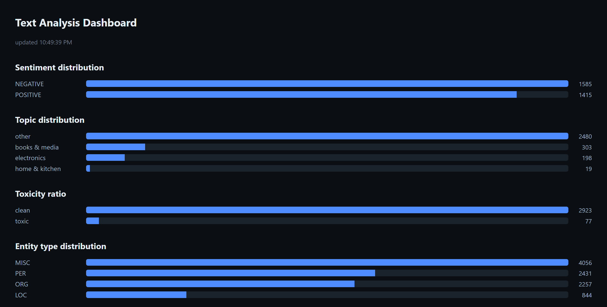
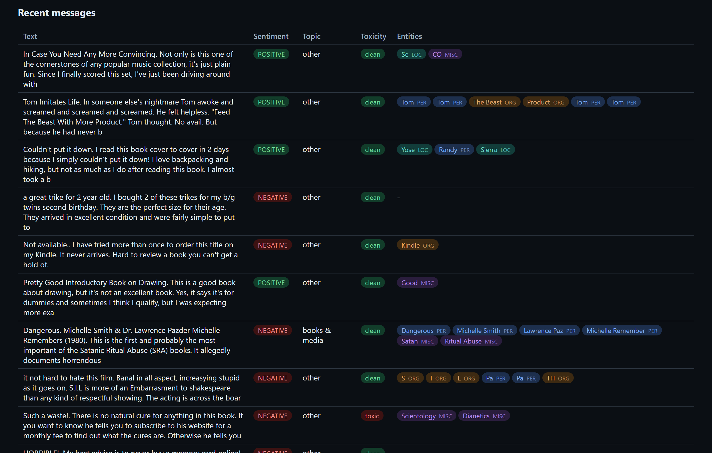
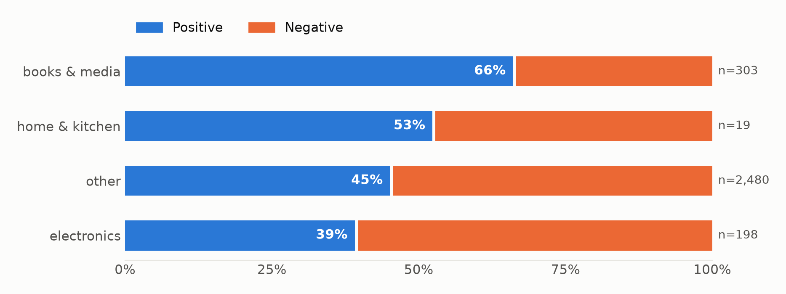
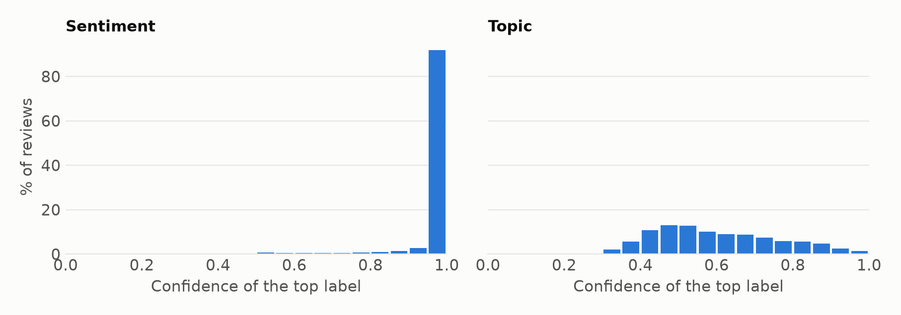
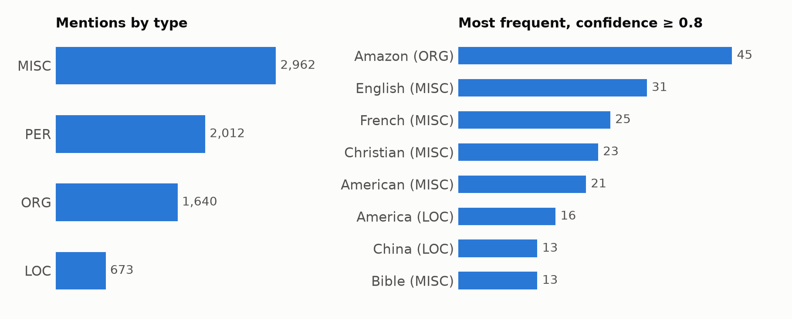
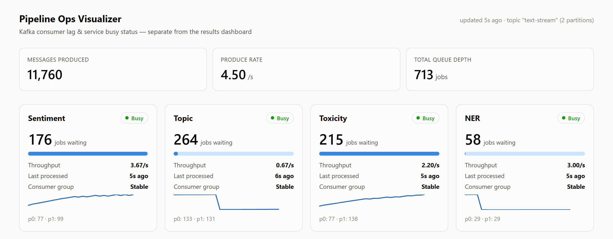
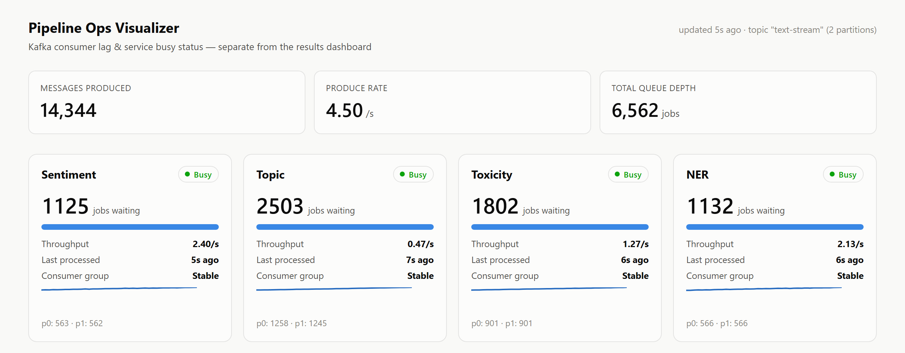
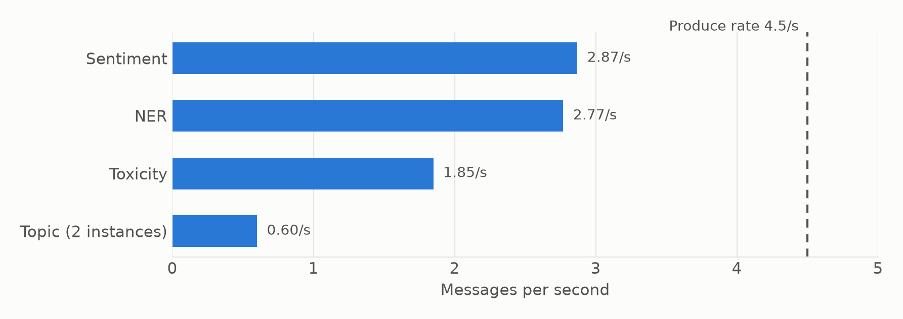
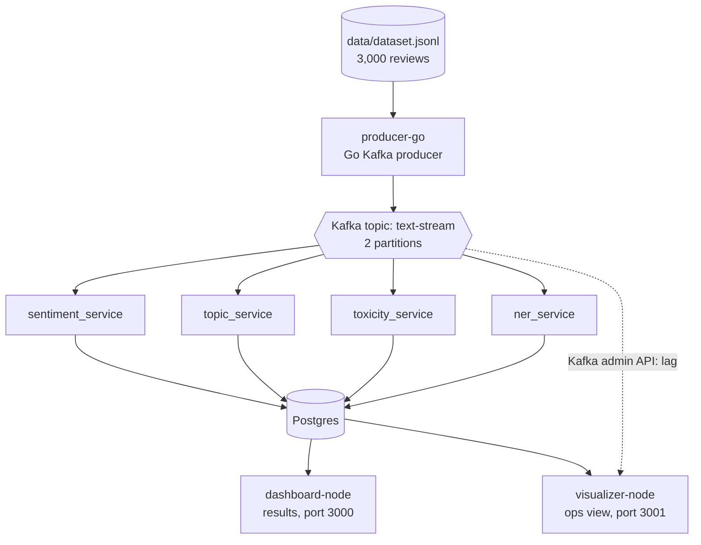

# Kafka + NLP Text Analysis Pipeline

A streaming pipeline that replays 3,000 Amazon reviews through Kafka, analyzes
each one with four independent NLP services (sentiment, topic, toxicity, and
named entities), and shows the results on a live dashboard.



- [Results](#results)
- [Architecture](#architecture)
- [Flow](#flow)
- [Setup](#setup)
- [Running the pipeline](#running-the-pipeline)

## Results

All figures cover the same 3,000 reviews, sampled from HuggingFace
`amazon_polarity`. Results were built up over two runs: the first produced
sentiment, topic, and toxicity, and the second added NER and supplied the
throughput figures. The second run reprocessed all of sentiment and part of
topic and toxicity, and their counts didn't change. The dataset's labels are
dropped on export, so
**no accuracy is measured here**. The results below describe what the models
output, and the errors quoted are individual reviews checked by hand.

| Service | Model | Result |
| --- | --- | --- |
| Sentiment | `distilbert-base-uncased-finetuned-sst-2-english` | 1,585 negative (52.8%), 1,415 positive (47.2%) |
| Topic | `valhalla/distilbart-mnli-12-1` (zero-shot) | 2,480 other (82.7%), 303 books & media, 198 electronics, 19 home & kitchen |
| Toxicity | `unitary/toxic-bert` | 77 toxic (2.6%), 2,923 clean |
| NER | `distilbert-base-cased` fine-tuned on CoNLL-2003 | 9,588 mentions, in 2,158 of 3,000 reviews (71.9%) |

### Dashboard: every review, four analyses

The dashboard refreshes every 5 seconds and joins the four services' results
for each review.



### Sentiment by topic

Reviews the model filed under books & media are the most positive, and
electronics the most negative. Only the first and last rows are large enough to
compare: home & kitchen has just 19 reviews, and "other" is a catch-all.



### Model confidence

The two classifiers behave very differently. Sentiment is almost always certain:
94.6% of its predictions score at least 0.9. Topic is usually unsure, with a mean
top score of 0.60, and 31.8% of predictions fall below 0.5.



High confidence doesn't guarantee a correct answer. One review titled "a great
trike for 2 year old" ends "I have nothing negative to say about the trike. An
excellent product", and was labelled NEGATIVE at 0.92.

### Topic: most reviews land in "other"

The "other" label absorbs most reviews, including many that clearly belong to a
named category:

| Reviews containing | Count | Labelled "other" |
| --- | --- | --- |
| "this book" | 507 | 380 (75%) |
| "this movie" or "this film" | 154 | 147 (95%) |

The candidate labels are the likely cause, since `books & media` is the only
one that fits these reviews and `other` is always available as an easy match.
Removing `other`, or using more specific labels, would be the first thing to
try. That hasn't been tested.

### Toxicity: flags harsh complaints

The model flags 77 reviews, and 71 of those (92%) are also negative. It was
trained on toxic online comments rather than product reviews, so it can mistake
a strongly worded complaint for abuse. A review of ear-mite medicine that ends
"Sucks sucks suck!" scored 0.99, though it attacks a product rather than a
person.

### Named entities



These charts exclude fragments of 1 or 2 characters, leaving 7,287 of 9,588
mentions, so their totals are lower than the dashboard's. The right-hand chart
also keeps only mentions with a confidence of at least 0.8.

Clear entities come through well (`Amazon`, `China`, `Steve Martin`), but the
output is noisy:

- **Fragments:** 24% of mentions (2,301) are 1 or 2 characters long, such as
  `S`, `T`, or `Du` from "Dune".
- **Low confidence:** the mean score is 0.72 even with fragments excluded.
- **Domain mismatch:** the model was trained on news text, not reviews.
- **Partly trained model:** this run used `checkpoint-878`, saved after 1 of the
  3 configured training epochs (validation F1 0.904). No test-set score exists
  for it, and a full training run may do better.

### Pipeline performance

The Ops Visualizer tracks Kafka consumer lag and busy/idle status for each
service. Early in the run, the backlog is still small, but Topic's throughput
is already far below the others:



Ten minutes later, the producer has outrun every consumer, and Topic has fallen
furthest behind:



No consumer kept up with the producer's 4.5 messages/s. Because each one has its
own consumer group, slow services fall behind without holding up the others, and
Kafka holds their backlog for them, up to its retention limit (7 days by default).



Topic is the bottleneck: even with two instances it managed 0.60 messages/s,
which would take about 83 minutes for all 3,000 reviews. Throughput was measured
on a 16-core WSL2 machine, on CPU, with all five consumer processes competing for
it (4 threads each), so expect different numbers on other hardware.

## Architecture



| Component | Stack | Role |
| --- | --- | --- |
| `producer-go` | Go | Replays the dataset into Kafka at a fixed rate |
| Kafka | Apache Kafka 3.8 (KRaft) | Buffers messages and tracks each service's position |
| `consumers-python` | Python, Hugging Face Transformers | Four independent NLP consumers |
| Postgres | PostgreSQL 16 | Stores messages and one results table per service |
| `dashboard-node` | Express, vanilla JS | Shows analysis results |
| `visualizer-node` | Express, vanilla JS | Shows lag, throughput, and service status |

## Flow

1. **Export:** `data/export_dataset.py` samples 3,000 reviews into
   `data/dataset.jsonl`, dropping their labels.
2. **Produce:** `producer-go` publishes each review to the `text-stream` topic.
3. **Consume:** each NLP service reads the full stream in its own consumer group,
   so every service sees every message and tracks its own progress. Running more
   instances in a group shares that group's work across the topic's partitions.
4. **Store:** each service upserts the review into `messages` and writes its own
   result row in one transaction, keyed by `message_id`, so replaying data is
   safe and the latest result wins.
5. **Commit:** only then does the service commit the message's Kafka offset.
6. **Display:** the dashboard polls Postgres for results, and the visualizer polls
   Kafka and Postgres for operational status.

### Delivery guarantees

Consumers process each message **at least once**, and never skip one silently:

- **Manual offset commits.** Auto-commit is off. A service commits a message's
  offset only after its result is stored, so a crash mid-message means the
  message is redelivered on restart, not lost.
- **Retries, then a dead-letter topic.** A failing message is retried
  (`CONSUMER_MAX_ATTEMPTS`, default 3, with linear backoff). If it still fails,
  or isn't valid JSON, it is copied to `text-stream.dlq` with headers recording
  its source offset, the consumer group, and the error, and the service moves on.
  If even the dead-letter write fails, the offset stays uncommitted and the
  service stops, so the message is retried after a restart.
- **Safe redelivery.** Because results are upserted by `message_id`, processing a
  message twice gives the same final state.
- **Database recovery.** Each message is one Postgres transaction that rolls back
  on error, so one bad statement can't leave the connection stuck, and a dropped
  connection is replaced on the next message.

Inspect parked messages in Kafka UI, or with
`docker exec kafka /opt/kafka/bin/kafka-console-consumer.sh --bootstrap-server localhost:9092 --topic text-stream.dlq --from-beginning --property print.headers=true`.

## Tests

The delivery logic is covered by unit tests that use in-memory fakes for Kafka
and Postgres, so they need no running infrastructure:

```bash
cd consumers-python && poetry run pip install pytest && poetry run pytest tests
```

GitHub Actions runs them on every push.

## Prerequisites

- Docker + Docker Compose plugin (for Kafka + Postgres)
- Go 1.23+
- Python 3.12+ with Poetry
- Node.js 20+ (installed here via `nvm`)

## Setup

1. Copy env file: `cp .env.example .env` (required: Postgres credentials have no built-in defaults)
2. Start infra: `docker compose up -d`
3. Install Python deps: `cd consumers-python && poetry install`
4. Export the dataset (one-time): `poetry run python ../data/export_dataset.py`
5. Fine-tune the NER model (one-time, CPU-only, ~30-45 min on a modern
   multi-core machine — hardware-dependent):
   `cd consumers-python && poetry run python -m ner_service.training.train_ner`
   — downloads CoNLL-2003 and fine-tunes `distilbert-base-cased` for token
   classification, saving weights to `consumers-python/ner_service/artifacts/ner-bert/`.
   `ner_service` refuses to start without this artifact. Safe to run in the
   background (e.g. `nohup ... &`); it prints entity-level precision/recall/F1
   per epoch and a final test-set report when done.
6. Install Node deps: `cd dashboard-node && npm install`, and `cd visualizer-node && npm install`
7. Build the Go producer: `cd producer-go && go build -o producer ./cmd/producer`

## Running the pipeline

Fastest path — one script starts infra, producer, all four consumers,
the dashboard, and the visualizer (each backgrounded, logging to `logs/`):

```bash
./scripts/start-all.sh   # brings everything up
tail -f logs/*.log       # optional: watch all logs together
./scripts/stop-all.sh    # stops the app processes (leaves Kafka/Postgres running)
./scripts/stop-all.sh --with-infra   # also runs `docker compose down`
```

Or run each piece by hand, in separate terminals:

```bash
# 1. Producer - streams data/dataset.jsonl into Kafka
cd producer-go && ./producer

# 2. Consumers - each is an independent process/consumer group
cd consumers-python && poetry run python -m sentiment_service.main
cd consumers-python && poetry run python -m topic_service.main
cd consumers-python && poetry run python -m toxicity_service.main
cd consumers-python && poetry run python -m ner_service.main   # requires the training step above

# 3. Dashboard
cd dashboard-node && npm start
# open http://localhost:3000

# 4. Ops visualizer (queue depth + busy/idle/down per service)
cd visualizer-node && npm start
# open http://localhost:3001
```

Kafka UI (topic/consumer group inspection) is available at http://localhost:8080.

## Notes

- Dataset labels are intentionally ignored; sentiment/topic/toxicity results
  come from pretrained/off-the-shelf models, not models trained on this data.
  `ner_service` is the exception: it runs a model fine-tuned locally on
  CoNLL-2003 (see Setup step 5), not a model trained on the review data itself.
- Each consumer writes `messages` once (idempotent upsert) plus its own
  result row (`sentiment_results` / `topic_results` / `toxicity_results` /
  `ner_results`), keyed by `message_id` with "latest result wins" semantics.
- `ner_results.entities` is a JSONB array of `{text, label, score, start, end}`
  per message. Amazon reviews are more entity-sparse than CoNLL-2003's
  news-domain training data, so many messages will show no entities — that's
  expected, not a bug.
- `db/init/001_init.sql` only runs on a fresh Postgres volume (Docker's
  `docker-entrypoint-initdb.d` behavior). If you already have a running
  Postgres volume from before `ner_results` was added, either recreate it
  (`docker compose down -v && docker compose up -d`) or apply the new
  `CREATE TABLE ner_results` / `CREATE INDEX idx_ner_processed_at` statements
  by hand via `docker exec -i postgres psql -U textanalysis -d textanalysis`.
- `PRODUCER_LOOP=true` in `.env` makes the producer replay the dataset
  indefinitely, useful for a longer-running dashboard demo.
